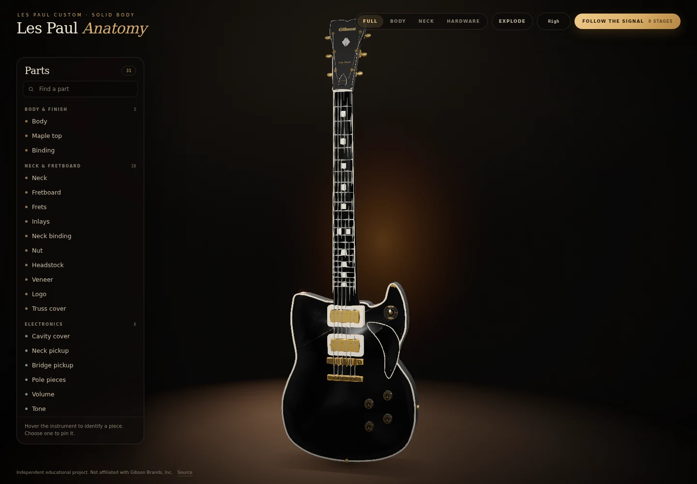
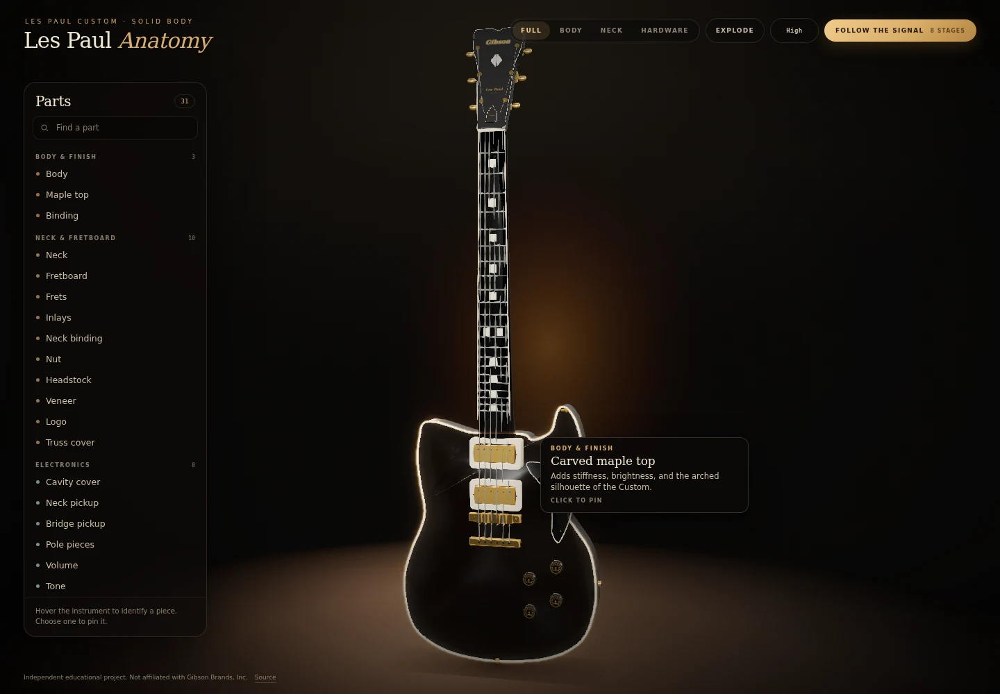
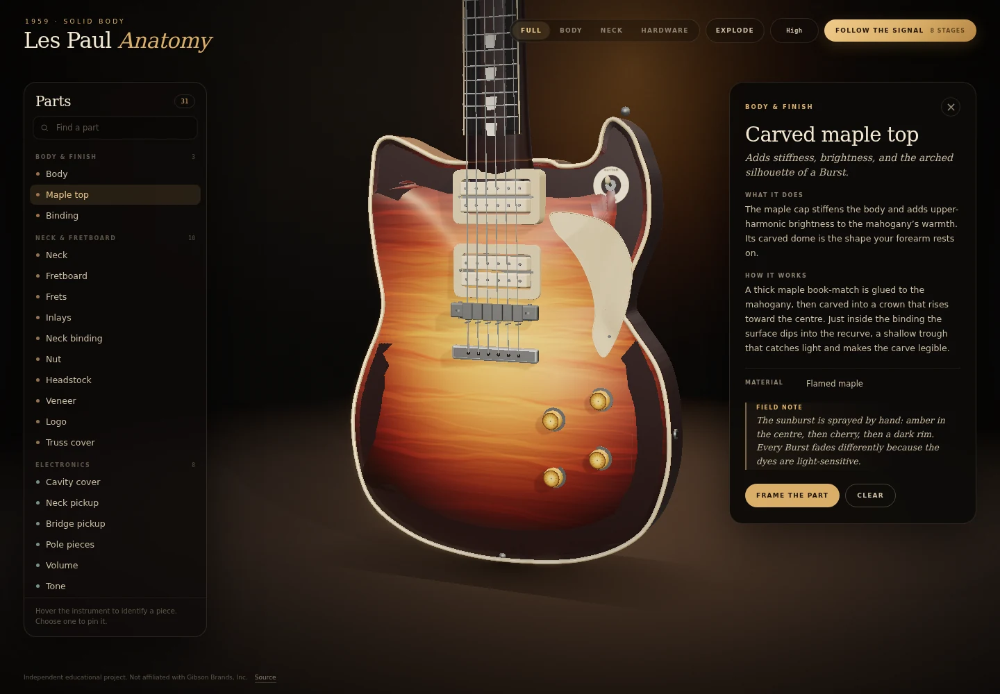
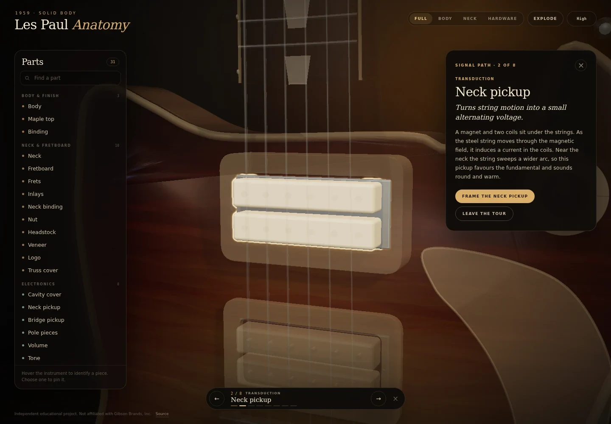
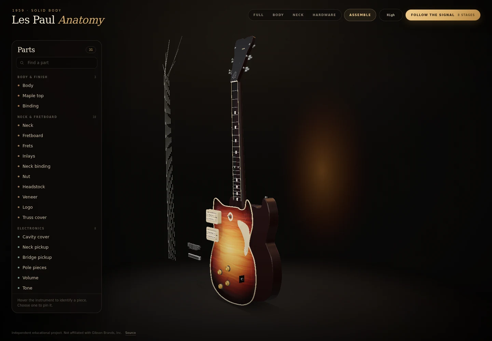
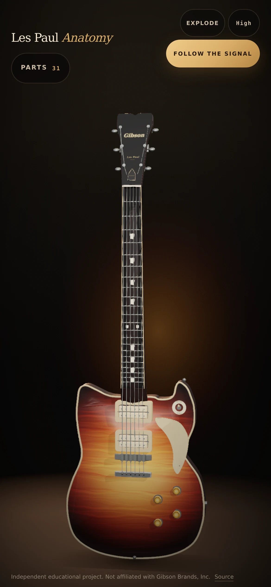
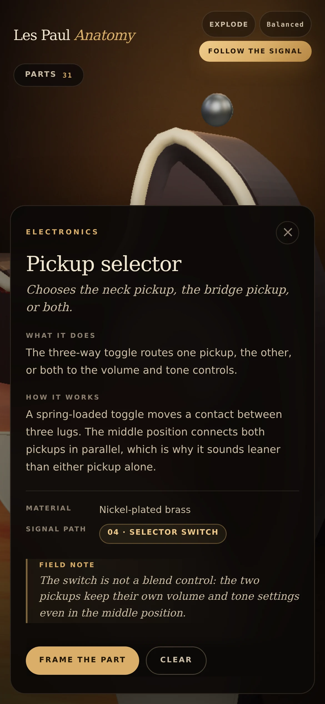

# Les Paul Anatomy

**A photoreal, interactive 3D anatomy of a 1959 Gibson Les Paul Standard.** Every visible part is named and explained, and the whole electrical story runs from the strings to the amplifier.

[**Open the live instrument →**](https://gerrcass.github.io/les-paul-3d-explorer/)



## What this is

The model is built entirely from code — geometry, flamed-maple sunburst, rosewood grain, cream plastics, nickel hardware, and the studio lighting. There are no downloaded models or image textures, and the page makes no network requests after it loads.

- **31 parts**, each with a name, a purpose, a mechanism, a material, and a field note.
- **Hover** any part for a quick identification card and a gold outline.
- **Click** to pin the full inspector, frame the part, and keep reading while you orbit.
- **Parts index** with categories and search, keyboard navigation, and camera focus.
- **Signal Path** tour: strings → neck pickup → bridge pickup → selector → volume → tone → output jack → amplifier. Unrelated parts dim; the current stage stays lit.
- **Exploded view** separates the strings, pickups, hardware, top, and body so the stacking is visible.
- **Quality tiers** (High, Balanced, Lite) auto-select for the device and can be cycled from the toolbar.
- **Responsive** from a 360 px phone to a 2560 px display, with a bottom-sheet inspector and touch-first controls.
- **Accessible**: reduced-motion support, keyboard controls, visible focus states, live regions, and a text-only fallback when WebGL is unavailable.

## Try it

| Action | Mouse / keyboard | Touch |
| --- | --- | --- |
| Orbit | Drag | One finger drag |
| Zoom | Scroll | Pinch |
| Identify | Hover a part | Tap a part |
| Pin a part | Click | Tap |
| Clear | `Esc` or **Clear** | **Clear** |
| Move through parts | Arrow keys in the index | Scroll the index |
| Explode / assemble | `E` or **Explode** | **Explode** |
| Start the signal path | `S` or **Follow the signal** | **Follow the signal** |
| Search | `/` | **Parts** → search |

## How an electric guitar works

The tour is the short version of the whole instrument:

1. **Strings** — the only part that physically vibrates. A pluck changes tension and sets the string swinging.
2. **Neck pickup** — a magnet and two coils turn that motion into a small alternating voltage. Near the neck the string sweeps a wider arc, so the sound is round and fundamental-heavy.
3. **Bridge pickup** — the same job closer to the bridge, where the tighter arc produces more upper harmonics and bite.
4. **Selector switch** — routes the neck pickup, the bridge pickup, or both in parallel.
5. **Volume controls** — variable resistors to ground; they set the level reaching the jack and interact with cable capacitance to soften treble as you turn down.
6. **Tone controls** — a potentiometer and a 0.022 µF capacitor bleed treble to ground. Turning down darkens rather than silences.
7. **Output jack** — a 1/4-inch mono connection: tip is hot, sleeve is ground.
8. **Amplifier** — not part of the guitar, but the destination: preamp, tone stack, power amp, speaker.

A **humbucker** uses two coils with opposite winding and polarity. String motion induces signal in both; hum is cancelled while the guitar signal adds. The **Tune-o-matic** bridge sets intonation saddle by saddle, and the **stopbar** behind it sets the break angle and anchors the ball ends.

## The parts

| Category | Parts |
| --- | --- |
| Body & finish | Mahogany body, carved maple top, body binding, pickguard, control-cavity cover |
| Neck & fretboard | Set neck, rosewood fretboard, frets, trapezoid inlays, fretboard binding, bone nut, headstock, headstock veneer, logo, truss-rod cover |
| Electronics | Neck humbucker, bridge humbucker, pole pieces, volume controls, tone controls, pickup selector, output jack |
| Hardware | Tuning machines, pickup rings, Tune-o-matic bridge, saddles, bridge posts & thumbwheels, stopbar tailpiece, poker chip, strap buttons |
| Strings | Strings |

The complete definitions, including what each part does and how it works, live in the app and in the [part registry](src/domain/parts.ts).

## Screenshots

| Hover to identify | Pin to inspect |
| --- | --- |
|  |  |
| **Signal path tour** | **Exploded view** |
|  |  |
| **Mobile** | **Mobile inspector** |
|  |  |

## Development

```bash
npm install
npm run dev        # local Vite server
npm run check      # typecheck + unit tests + production build
npm run preview    # serve the production build
```

The test suite builds the complete instrument headlessly and asserts that every pickable mesh resolves to a registered part, that every part has geometry, that the body and scale dimensions are in range, and that the signal-path tour state machine behaves. See `tests/`.

## Architecture

- **`src/domain/`** — pure vocabulary and state: the Part Registry, signal path, and tour machine. No Three.js or DOM.
- **`src/scene/`** — procedural geometry, materials, textures, studio, camera, and the composition of the instrument.
- **`src/interaction/`** — raycasting, hover, pin, and highlight state.
- **`src/ui/`** — the parts index, tooltip, inspector, tour bar, and fallback.
- **`src/main.ts`** — the composition root and render loop.

Design decisions are recorded in [docs/adr](docs/adr/), the product brief in [docs/design-brief.md](docs/design-brief.md), and the domain vocabulary in [GLOSSARY.md](GLOSSARY.md). The Part Registry is the single semantic seam shared by the scene and every UI surface (ADR-0003).

## Deployment

A GitHub Actions workflow runs `npm run check` on pull requests and deploys the production bundle to GitHub Pages on every push to `main`. Vite uses a relative base, so the same build works at the Pages subpath and from a local server.

Live site: **https://gerrcass.github.io/les-paul-3d-explorer/**

## Disclaimer

This is an independent educational project. It is not affiliated with, endorsed by, or sponsored by Gibson Brands, Inc. “Gibson” and “Les Paul” are trademarks of their respective owners. The instrument is depicted for teaching purposes.

Built with [Three.js](https://threejs.org/), TypeScript, and Vite.
